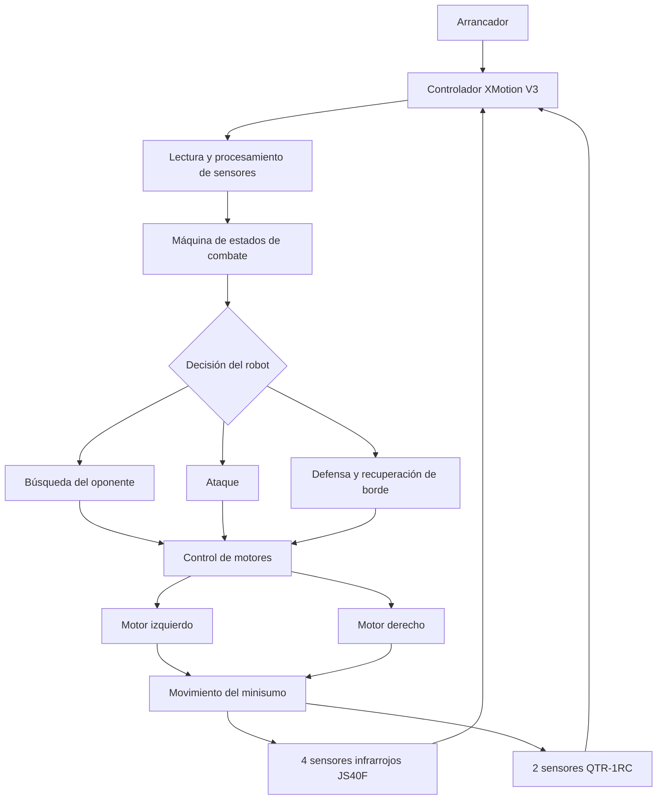

# Misión y arquitectura del equipo

**Plataforma:** M01 — Mini-sumo autónomo (XMotion V3)  
**Propósito real y escenario:** Diseñar, construir y programar un robot minisumo autónomo capaz de detectar a un oponente, buscarlo, atacar y evitar salir del dohyo. El robot participa en combates dentro de una superficie delimitada, por lo que necesita responder rápidamente a las señales de sus sensores y ejecutar estrategias de movimiento y defensa.

## Objetivo verificable del robot

El objetivo del robot es detectar a un oponente mediante sus sensores infrarrojos JS40F, buscarlo y ejecutar movimientos de ataque utilizando sus motores de 6 V y 750 RPM. Al mismo tiempo, debe identificar los límites del dohyo mediante sus dos sensores QTR-1RC para evitar salir de la superficie y activar una respuesta de recuperación o defensa. El sistema debe funcionar de manera autónoma después de activar el arrancador y completar un combate sin perder el control del movimiento. El criterio de éxito establecido para la demostración fue que todos los sistemas funcionaran correctamente y que el robot consiguiera ganar el combate, resultado que se alcanzó durante la demostración final.

## Arquitectura de alto nivel

| Subsistema | Función | Entradas | Salidas | Responsable / alcance |
|---|---|---|---|---|
| Mecánica | Integrar y mantener fijos los componentes del minisumo, motores, sensores y batería. | Estructura, componentes y fijaciones. | Robot ensamblado y listo para operar. | Equipo Jamón |
| Sensores | Detectar al oponente y reconocer los límites del dohyo. | Señales de los 4 sensores infrarrojos JS40F y 2 sensores QTR-1RC. | Señales digitales de detección y lecturas de los sensores de borde. | Juan: MS11 y MS09. Melissa: MS05. |
| Control | Coordinar las decisiones del robot según las señales de los sensores y el estado de combate. | Lecturas de sensores y estado del sistema. | Decisiones de búsqueda, ataque, defensa y recuperación de borde. | Juan y Melissa: MS08. |
| Actuadores | Generar el movimiento del robot mediante los motores. | Señales de control de la tarjeta XMotion V3. | Giro, avance, retroceso y movimiento de ataque. | Melissa: MS03. |
| Software/ROS/Python | Ejecutar la lógica autónoma, administrar los estados de combate y controlar los componentes. | Lecturas de sensores, configuración y señal de arranque. | Órdenes de movimiento y respuestas de combate. | Juan: MS08 y MS09. Melissa: MS08. |

## Diagrama

## Dependencias críticas

- **Disponibilidad de componentes y herramientas:**
  - Controlador XMotion All In One V3.
  - 4 sensores infrarrojos digitales JS40F para detección del oponente.
  - 2 sensores QTR-1RC para detección de los límites del dohyo.
  - Motores JSumo Core de 6 V y 750 RPM.
  - Batería LiPo 3S de 11.4 V y 300 mAh.
  - Arrancador integrado y conexiones eléctricas.
  - Herramientas para soldadura y montaje de componentes.
  - Dohyo para realizar la calibración y las pruebas de funcionamiento.

- **Software y versiones:**
  - Arduino IDE y librería `xmotionV3.h` para la programación del controlador.
  - Código en C/C++ para la lógica de búsqueda, ataque, defensa y recuperación de borde.
  - Ajustes de umbral para las lecturas de los sensores QTR-1RC.
  - Configuración de los motores mediante los parámetros `CALIB_L` y `CALIB_R`.
  - No se utilizó ROS como parte de la arquitectura del minisumo.

- **Condiciones de arena/pista/espacio de vuelo/escenario AMR:**
  - Superficie de combate tipo dohyo.
  - Sensores QTR-1RC calibrados de acuerdo con las características de la superficie.
  - Espacio delimitado y libre de obstáculos ajenos al combate.
  - Condiciones adecuadas para realizar pruebas de movimiento y detección del oponente.
  - Verificación del funcionamiento de los sensores antes de cada demostración, especialmente cuando se utiliza un dohyo diferente.

## Interfaces entre alcances

El desarrollo del minisumo requiere que los diferentes alcances trabajen de manera coordinada, ya que las decisiones del código dependen de las lecturas de los sensores y estas, a su vez, determinan el movimiento de los motores.

- **Juan Arturo López Delgado — MS08, MS11 y MS09:** trabaja en la máquina de estados de combate, la recuperación de borde y la estrategia de búsqueda. Necesita que los sensores entreguen señales confiables para tomar decisiones y que el sistema de motores responda correctamente a las instrucciones del código.

- **Melissa Zúñiga Miranda — MS03, MS08 y MS05:** trabaja en la motorización, la máquina de estados y los sensores de borde. Necesita que la lógica de control esté integrada con los motores y que los sensores QTR-1RC estén calibrados para detectar correctamente los límites del dohyo.

### Acuerdos de integración

1. Los sensores infrarrojos JS40F proporcionan la información necesaria para detectar al oponente y activar la estrategia de búsqueda o ataque.
2. Los sensores QTR-1RC permiten identificar los límites del dohyo y activar la respuesta defensiva o de recuperación.
3. La máquina de estados coordina las decisiones del robot y evita que las acciones de búsqueda, ataque y defensa entren en conflicto.
4. Los motores deben responder de manera coordinada a las instrucciones del controlador para mantener un movimiento equilibrado.
5. Antes de cada demostración se deben revisar las conexiones y calibrar nuevamente los sensores cuando cambien las condiciones de la superficie.
6. Los cambios de hardware y software deben probarse antes de integrarse a la versión final del robot.

La integración de estos alcances permitió que el equipo terminara de ajustar el código, mejorara la estrategia defensiva, recalibrara los sensores para otro dohyo e implementara el arrancador en la salida OTR (A1). Como resultado, el minisumo funcionó correctamente durante la demostración final y consiguió ganar el combate.
